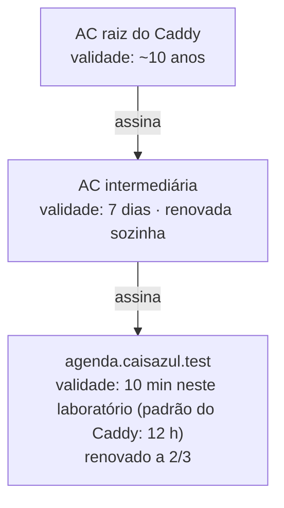

# 1. Revisão teórica: certificados de vida curta e renovação automática

> ⏱️ Leitura: cerca de 15 minutos. Leia antes de abrir o roteiro: cada etapa aplica um item desta revisão.

**Nesta página**

1. [O problema: certificados vencem](#11-o-problema-certificados-vencem)
2. [Por que encurtar a validade?](#12-por-que-encurtar-a-validade)
3. [Renovação automática e a regra dos 2/3](#13-renovação-automática-e-a-regra-dos-23)
4. [O ACME em uma página](#14-o-acme-em-uma-página)
5. [AC interna: quando a empresa é a própria AC](#15-ac-interna-quando-a-empresa-é-a-própria-ac)
6. [O Caddy e o Caddyfile](#16-o-caddy-e-o-caddyfile)
7. [HSTS em um parágrafo](#17-hsts-em-um-parágrafo)
8. [Da teoria ao roteiro](#18-da-teoria-ao-roteiro)
9. [Autoavaliação](#19-autoavaliação)

---

## 1.1 O problema: certificados vencem

Um **certificado digital** liga a **chave pública** de um site ao nome do site e é assinado por uma **Autoridade Certificadora (AC)**. Todo certificado tem **validade**: depois da data `notAfter`, navegadores e programas o recusam (no Chrome, o alerta é `NET::ERR_CERT_DATE_INVALID`).

Renovar "na mão" depende de alguém lembrar, pedir o certificado novo, instalá-lo e reiniciar o servidor — no prazo certo, mesmo de férias. Quando isso falha, o site sai do ar para todo mundo de uma vez. Grandes empresas já ficaram horas fora do ar por causa de um único certificado esquecido.

## 1.2 Por que encurtar a validade?

Parece contraditório: se vencer é um problema, por que os certificados públicos estão ficando **mais curtos**?

- **A revogação funciona mal na prática.** Se a chave privada de um site vaza, a AC pode **revogar** (cancelar) o certificado, mas muitos clientes não consultam essa informação a tempo. Na prática, um certificado comprometido continua sendo aceito até vencer.
- **Validade curta limita o estrago.** Um certificado de poucos dias vale pouco para quem roubou a chave.
- **Força a automação.** Ninguém renova à mão um certificado de poucos dias; com renovação automática, o esquecimento deixa de existir.

O **CA/Browser Forum**, que reúne ACs e fabricantes de navegadores e define as regras dos certificados públicos, aprovou em 2025 uma redução gradual da validade máxima:

| A partir de | Validade máxima de um certificado público de site |
|---|---|
| até 14/03/2026 | 398 dias |
| 15/03/2026 | 200 dias |
| 15/03/2027 | 100 dias |
| 15/03/2029 | 47 dias |

> **Certificado de vida curta** é o nome dado a certificados com validade de horas ou poucos dias. Neste laboratório, o certificado do site vai durar **10 minutos**, para que você veja o ciclo completo durante a aula.

## 1.3 Renovação automática e a regra dos 2/3

Na **renovação automática**, um programa no próprio servidor acompanha a validade do certificado, pede um novo e o instala sozinho, sem tirar o site do ar.

A pergunta é **quando** renovar. Renovar no último minuto não deixa margem para erro; renovar cedo demais gera trabalho à toa. A regra usada pelos clientes de renovação automática é:

> **Renovar quando restar 1/3 da validade** — ou seja, depois de usados **2/3**.

O terço que sobra é a **folga**: tempo para tentar de novo e avisar alguém, caso a renovação falhe (a AC fora do ar, uma configuração errada).

```text
Certificado de 10 minutos
0 min                         6 min 40 s             10 min
|---------- uso normal (2/3) ----------|--- folga (1/3) ---|
emissão                     renovação começa          vencimento
```

| Validade | Renovação após | Folga |
|---|---|---|
| 10 minutos (este laboratório) | ≈ 6 min 40 s | ≈ 3 min 20 s |
| 90 dias | 60 dias | 30 dias |

## 1.4 O ACME em uma página

Na internet, a renovação automática usa o protocolo **ACME** (*Automatic Certificate Management Environment*, ambiente de gerenciamento automático de certificados), criado pelo Let's Encrypt. Um **cliente ACME** no servidor conversa com a AC em seis passos:

1. **Pede** um certificado para um nome (ex.: `agenda.caisazul.com.br`).
2. Recebe um **desafio** da AC: provar que controla aquele nome.
3. **Prova** o controle — por exemplo, publicando um valor combinado num endereço do site (desafio HTTP-01) ou no DNS (desafio DNS-01).
4. Gera um **par de chaves novo** e envia o **CSR** (*Certificate Signing Request*, o pedido com a chave pública e o nome).
5. A **AC emite** o certificado.
6. O cliente **instala** o certificado e recarrega o servidor.

**O que este laboratório simplifica:** aqui o Caddy é **ao mesmo tempo a AC e o servidor**. Por isso, os passos 2 e 3 — a prova de controle do domínio — **não acontecem**. O que você vai observar de verdade é o ciclo de vida: emissão, vida curta, janela de renovação e troca automática sem queda do site.

## 1.5 AC interna: quando a empresa é a própria AC

Uma **AC interna** é uma autoridade certificadora da própria organização. Ela emite certificados para sistemas internos (intranet, servidores de teste, comunicação entre serviços) que não precisam ser reconhecidos pelo resto da internet.

- Seus certificados só são aceitos por computadores que tenham a **raiz** dela instalada como confiável. Numa empresa, a equipe de TI instala essa raiz em todas as máquinas por política centralizada.
- Quem controla a raiz interna pode emitir certificado para **qualquer nome** naqueles computadores — por isso a chave dela é um dos segredos mais sensíveis da empresa.

A AC interna do Caddy segue a estrutura que você já conhece:



## 1.6 O Caddy e o Caddyfile

O **Caddy** é um servidor web que liga o HTTPS automaticamente. Para um nome público, ele obtém certificados de uma AC pública pelo ACME; com a opção **`tls internal`**, ele usa a própria AC interna.

A configuração fica num arquivo de texto chamado **`Caddyfile`**, com duas partes:

| Parte | Exemplo neste laboratório |
|---|---|
| **Opções globais**, entre chaves no topo | portas, frequência de verificação, regra dos 2/3, nome da AC |
| **Blocos de site**, um por endereço | `agenda.caisazul.test:8443 { … }` com `tls internal`, validade de 10 min, cabeçalho HSTS e a resposta da página |

Abra o [`Caddyfile`](../Caddyfile) do repositório: cada linha está comentada.

O Caddy guarda a AC e os certificados na **pasta de dados**, que no Linux fica em `~/.local/share/caddy`. Ele também tem uma **API de administração**, que escuta só dentro da máquina (`localhost:2019`), usada para recarregar a configuração e consultar a AC.

## 1.7 HSTS em um parágrafo

O **HSTS** (*HTTP Strict Transport Security*) é um cabeçalho que o servidor envia nas respostas HTTPS: `Strict-Transport-Security: max-age=31536000`. A partir daí, o navegador passa a usar **só HTTPS** naquele site durante o tempo indicado (31.536.000 segundos = 1 ano), mesmo que alguém digite `http://`. Isso impede o ataque de rebaixamento que mantém a vítima numa conexão sem cadeado. Você vai conferir esse cabeçalho na etapa 3.

## 1.8 Da teoria ao roteiro

| Etapa do roteiro | Conceito aplicado |
|---|---|
| 1. Subir o servidor | Caddyfile, AC interna, emissão automática |
| 2. Conhecer a AC interna | raiz longa, intermediária e certificado do site curtos |
| 3. Acessar o site | confiar numa raiz, certificado de vida curta, HSTS |
| 4. Assistir à renovação | regra dos 2/3, troca sem queda do site |
| 5. Experimentos | folga, servidor desligado, mudar a janela de renovação |
| 6. Entrega | evidências e respostas |

## 1.9 Autoavaliação

Responda mentalmente antes de abrir o roteiro. Clique para conferir.

<details>
<summary><b>1.</b> Se a validade curta aumenta o número de renovações, por que ela é considerada mais segura?</summary>

Porque um certificado cuja chave vazou deixa de valer logo, sem depender da revogação, que funciona mal na prática. O número maior de renovações é resolvido com automação.
</details>

<details>
<summary><b>2.</b> Um certificado de 30 dias será renovado quando, pela regra dos 2/3?</summary>

Depois de 20 dias de uso, com 10 dias de folga.
</details>

<details>
<summary><b>3.</b> Qual passo do ACME não acontece neste laboratório, e por quê?</summary>

A prova de controle do domínio (desafio e prova), porque o Caddy é ao mesmo tempo a AC e o servidor.
</details>

<details>
<summary><b>4.</b> Por que o seu navegador não confiaria no certificado do PortalAgenda deste laboratório?</summary>

Porque ele foi emitido pela AC interna do Caddy, cuja raiz não está instalada no navegador. Só confia quem instalar essa raiz.
</details>

---

➡️ Próximo: [2. Roteiro passo a passo](02-roteiro.md)
