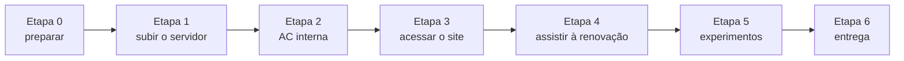

# 2. Roteiro: renovação automática de certificados, ao vivo

> ⏱️ Duração: cerca de 45 minutos. Pré-requisito: ter lido a [revisão teórica](01-revisao-teorica.md).

Você vai colocar no ar o **PortalAgenda** da Cais Azul (empresa fictícia) com o Caddy e uma AC interna. O certificado do site vale **10 minutos**, e você vai ver o Caddy trocá-lo sozinho quando 2/3 da validade tiverem passado — sem o site sair do ar.



**Convenções deste roteiro**

- Todos os comandos rodam na **raiz do repositório** (a pasta que o terminal do Codespace abre).
- Você vai usar **dois terminais**: o **terminal 1** mostra o diário (log) do servidor; o **terminal 2** é onde você digita os testes. Para abrir o segundo, clique no botão **+** do painel do terminal.
- 👀 **Observe** indica o que conferir na saída. Horas, números de série e datas serão diferentes dos exemplos.
- ✋ **Responda** indica a pergunta correspondente em [`ENTREGA.md`](../ENTREGA.md).
- 📎 **Evidência** indica uma saída que você salva na pasta `evidencias/` e entrega no commit.
- A hora do Codespace é **UTC**: 3 horas à frente do horário de Brasília.

> ⏰ **O relógio começa na etapa 1.** O primeiro certificado é emitido assim que o servidor sobe e será renovado cerca de 6 min 40 s depois. Faça as etapas 2 e 3 sem pausas longas, para começar a etapa 4 antes da primeira troca. Se perder a primeira, não tem problema: com 10 minutos de validade, outra troca acontece logo em seguida.

---

## Etapa 0 — Preparar o ambiente (3 min)

1. No seu repositório do laboratório no GitHub, clique em **Code → Codespaces → Create codespace on main**. Na primeira vez, a criação e a instalação do Caddy levam de 2 a 3 minutos.
2. Quando o terminal mostrar **"Ambiente pronto"**, confira:

```bash
caddy version
openssl version
```

👀 **Observe:** a versão do Caddy começa com **v2** e a do OpenSSL com **3**.

3. Abra o arquivo [`Caddyfile`](../Caddyfile) no editor e leia os comentários. Repare em três linhas: `lifetime 10m`, `renewal_window_ratio 0.3333` e `renew_interval 30s`.

---

## Etapa 1 — Subir o servidor (3 min)

No **terminal 1**:

```bash
caddy run --config Caddyfile 2>&1 | tee caddy.log
```

O terminal fica "preso" mostrando o log — é assim mesmo. **Deixe-o aberto até o fim da aula.**

👀 **Observe** nas linhas do log (formato JSON):

- a criação da AC interna, na primeira execução (procure por `pki` e pelo nome `AC Cais Azul Lab`);
- a emissão do certificado de `agenda.caisazul.test` (procure por `obtain` ou `certificate`).

> ⚠️ Se o Caddy reclamar da linha `renewal_window_ratio`, a versão instalada é anterior a essa opção. Apague a linha do `Caddyfile` (o padrão já é 1/3) e rode o comando de novo.

---

## Etapa 2 — Conhecer a AC interna (5 min)

No **terminal 2**:

```bash
# 2.1 Onde o Caddy guarda a AC e os certificados
find ~/.local/share/caddy -name '*.crt'

# 2.2 A raiz e a intermediária
CA=~/.local/share/caddy/pki/authorities/local
openssl x509 -in $CA/root.crt         -noout -subject -dates
openssl x509 -in $CA/intermediate.crt -noout -subject -issuer -dates
```

👀 **Observe:** a raiz vale cerca de **10 anos**; a intermediária, **7 dias**; o nome da AC é o definido no `Caddyfile`.

A mesma informação está na **API de administração** do Caddy, que só escuta dentro do Codespace:

```bash
curl -s localhost:2019/pki/ca/local | jq '{name, root_common_name, intermediate_common_name}'
```

> 💡 A variável `CA` vale só neste terminal. Se abrir outro terminal, defina-a de novo.

✋ **Responda:** pergunta 1.

---

## Etapa 3 — Acessar o site (6 min)

**3.1 Sem confiar na AC do Caddy** (como um navegador comum):

```bash
curl --resolve agenda.caisazul.test:8443:127.0.0.1 https://agenda.caisazul.test:8443/
```

👀 `curl: (60) SSL certificate problem: unable to get local issuer certificate` — a AC é desconhecida.

> `--resolve` faz o nome `agenda.caisazul.test` apontar para a própria máquina, sem precisar editar arquivos do sistema.

**3.2 Confiando na raiz do Caddy** (como um computador da empresa em que a TI instalou a raiz):

```bash
curl --cacert $CA/root.crt --resolve agenda.caisazul.test:8443:127.0.0.1 https://agenda.caisazul.test:8443/
```

👀 `PortalAgenda no ar. Hora do servidor: …`

**3.3 Os cabeçalhos da resposta:**

```bash
curl -sI --cacert $CA/root.crt --resolve agenda.caisazul.test:8443:127.0.0.1 https://agenda.caisazul.test:8443/
```

👀 Procure a linha `strict-transport-security: max-age=31536000` — é o HSTS.

**3.4 O certificado que o servidor está entregando agora:**

```bash
openssl s_client -connect 127.0.0.1:8443 -servername agenda.caisazul.test </dev/null 2>/dev/null \
  | openssl x509 -noout -serial -subject -issuer -dates -ext subjectAltName \
  | tee evidencias/certificado.txt
```

👀 **Observe:** o emissor é a **intermediária** do Caddy e a diferença entre `notBefore` e `notAfter` é de cerca de **10 minutos**. Anote o número de série.

📎 **Evidência:** a saída ficou salva em `evidencias/certificado.txt`.

✋ **Responda:** pergunta 2.

---

## Etapa 4 — Assistir à renovação (10 min)

No **terminal 2**:

```bash
bash observar.sh | tee evidencias/renovacao.txt
```

O script consulta o servidor a cada 15 segundos e mostra o certificado que ele está entregando naquele momento. **Deixe-o rodando também durante a etapa 5.**

```text
hora      série (final)   validade   tempo de vida usado       restam
17:02:10  …8F31A07C2D11     10 min  [############........]  61%  3 min 54 s
17:02:25  …8F31A07C2D11     10 min  [#############.......]  64%  3 min 39 s
17:02:40  …8F31A07C2D11     10 min  [#############.......]  66%  3 min 24 s
17:02:55  …4B90E2D17A65     10 min  [....................]   1%  9 min 55 s   <<< CERTIFICADO NOVO
```

👀 **Observe:**

- a barra enche até cerca de **2/3** e o certificado é trocado: a linha **`<<< CERTIFICADO NOVO`**;
- no **terminal 1**, no mesmo instante, o log registra a renovação;
- o site respondeu em todas as consultas: **não houve queda**.

> A troca pode aparecer um pouco depois dos 66%: o Caddy confere a validade a cada 30 s (`renew_interval`) e o `observar.sh`, a cada 15 s.

**Enquanto a barra enche**, responda à pergunta 3 (a tabela).

📎 **Evidência:** tudo o que o `observar.sh` mostrar fica salvo em `evidencias/renovacao.txt`.

✋ **Responda:** pergunta 3.

---

## Etapa 5 — Experimentos (12 min)

Mantenha o `observar.sh` rodando no terminal 2. O experimento 5.1 usa o **terminal 1** (o do Caddy); para os experimentos 5.2 e 5.3, abra um **terceiro terminal** com o botão **+**.

**5.1 O servidor estava desligado na hora da renovação**

1. Espere o certificado atual chegar a cerca de **50%** de uso.
2. Pare o Caddy com **Ctrl + C** no terminal 1. O `observar.sh` passa a mostrar *servidor não respondeu*.
3. Espere cerca de **3 minutos**, até passar da marca de 2/3 — mas **antes** dos 10 minutos de validade.
4. Suba o Caddy de novo, com o mesmo comando da etapa 1.

👀 **Observe:** ao iniciar, o Caddy encontra o certificado guardado já dentro da janela de renovação e o troca logo em seguida. No `observar.sh`, o site volta e aparece um `<<< CERTIFICADO NOVO`.

✋ **Responda:** pergunta 4.

**5.2 Mudar a regra de renovação**

1. No `Caddyfile`, troque `renewal_window_ratio 0.3333` por `renewal_window_ratio 0.5`.
2. No terminal 3, recarregue a configuração **sem derrubar o servidor**:

```bash
caddy reload --config Caddyfile
```

👀 **Observe** no `observar.sh`: a próxima troca acontece por volta de **50%** de uso (cerca de 5 minutos).

3. Depois de ver a troca, **volte o valor para 0.3333** e recarregue de novo.

✋ **Responda:** pergunta 5.

**5.3 Ler o log como um operador** (opcional)

No terminal 3, filtre só os eventos de certificado do log:

```bash
jq -rR 'fromjson? | select(.msg | test("renew|obtain|certificate"; "i"))
        | "\(.ts | floor | todate)  \(.msg)"' caddy.log
```

👀 Cada renovação aparece com data e hora (UTC). Compare com as linhas `<<< CERTIFICADO NOVO`.

Ao terminar, pare o `observar.sh` com **Ctrl + C** no terminal 2.

---

## Etapa 6 — Conferir e entregar (6 min)

**6.1 Responder** às perguntas que faltam em [`ENTREGA.md`](../ENTREGA.md), incluindo a pergunta 6.

**6.2 Rodar a verificação automática:**

```bash
bash scripts/verificar.sh
```

Corrija o que aparecer com ✗.

**6.3 Fazer o commit e enviar:**

```bash
git add ENTREGA.md evidencias/
git commit -m "Entrega do laboratório de renovação automática"
git push
```

**6.4** No GitHub, abra a aba **Actions** do seu repositório: a verificação roda de novo na nuvem e deve terminar com ✅.

**6.5 Encerrar:** **Ctrl + C** no terminal 1 e pare o Codespace para não gastar a sua cota: no GitHub, **Code → Codespaces → ⋯ → Stop codespace**.

---

➡️ Terminou antes? Veja os [desafios extras](03-desafios.md).
